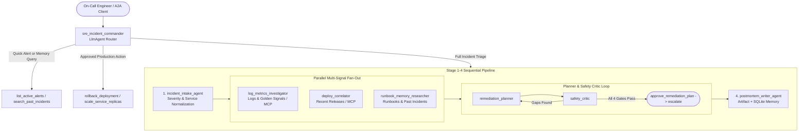

# Architecture & Design Deep Dive

## 1. Multi-Agent Orchestration Topology

The **SRE Triage & Postmortem Commander** combines LLM routing with deterministic ADK workflow primitives (`SequentialAgent`, `ParallelAgent`, `LoopAgent`) so investigations are fast, repeatable, and safety-audited:

## 2. State, Context Hygiene & Memory Layers

| Layer | Mechanism | Purpose |
| :--- | :--- | :--- |
| **Short-Term Working Context** | ADK Session `state` (`output_key`) | Passes structured summaries (`incident_intake`, `log_metrics_findings`, `deploy_findings`, `runbook_memory_findings`, `remediation_plan`) cleanly across stages without bloated raw logs. |
| **Context Window Hygiene** | `Settings.max_log_lines` | Bounds log retrieval payloads so verbose outages never overflow context. |
| **Long-Term Institutional Memory** | `IncidentMemoryStore` (SQLite) | Persists resolved root causes, mitigations, and lessons learned across sessions and restarts; pre-seeded with historical outages. |
| **Downloadable Artifacts** | `ToolContext.save_artifact` | Exports standardized GitHub-Flavored Markdown blameless postmortems (`postmortem_<id>.md`). |

## 3. Safety Guardrails & Security Model

1. **Human-in-the-Loop Approval Gate (`before_tool_guardrail_callback`)**:
   - Destructive production tools (`rollback_deployment`, `scale_service_replicas`) are automatically intercepted before execution unless an explicit `human_approval_token` or session-level approval flag is present.
   - Blocked calls return a structured `blocked_pending_approval` payload instructing the agent to request human confirmation.
2. **Outbound PII & Secret Redaction (`before_model_guardrail_callback`)**:
   - Strips Google API keys (`AIza...`), bearer tokens, `sk-...` secrets, and SSNs from outbound LLM payloads before model invocation.
3. **Least-Privilege Cloud Run IAM (Terraform)**:
   - Runs as a non-root container user (`uid 10001`) with a dedicated GCP service account granted only `roles/aiplatform.user`, `roles/cloudtrace.agent`, and `roles/logging.logWriter`.

## 4. Observability & Evaluation

- **OpenTelemetry**: Pluggable `TracerProvider` supporting `console`, `otlp`, and `gcp_trace` (`CloudTraceSpanExporter`), creating spans for every LLM and tool invocation.
- **Structured JSON Logging**: Cloud Logging-compatible formatter including `trace_id`, `agent_name`, `tool_name`, `latency_ms`, and `guardrail` fields.
- **Runtime Metrics**: Exposed at `GET /metrics` (tool call counts, error counts, average latencies, token totals, guardrail blocks, PII redactions).
- **Evaluations**:
  - `eval/sre_triage.evalset.json` + `eval/test_config.json` for `adk eval` trajectory & response matching.
  - `python3 -m eval.run_evals --mode offline` for deterministic CI regression checks.
